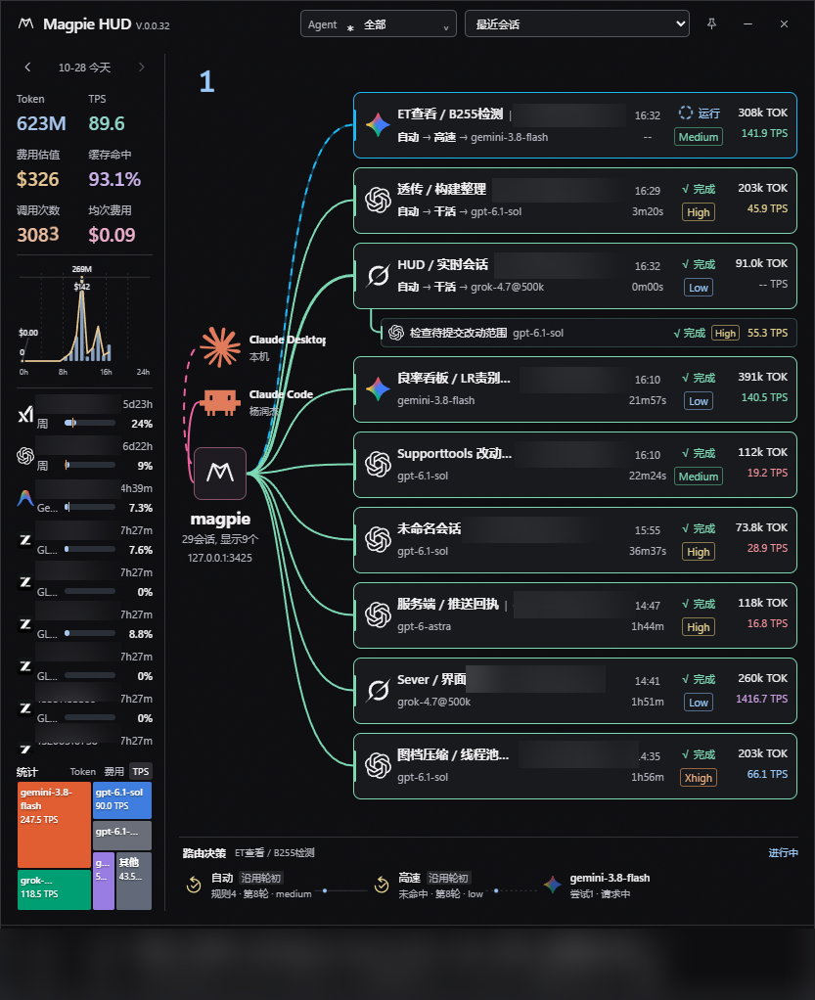
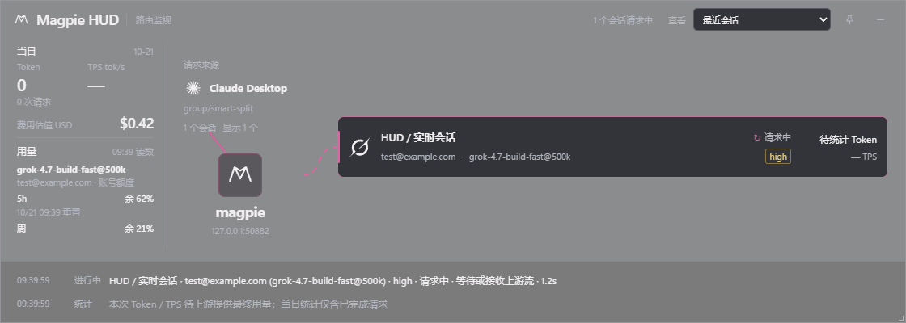
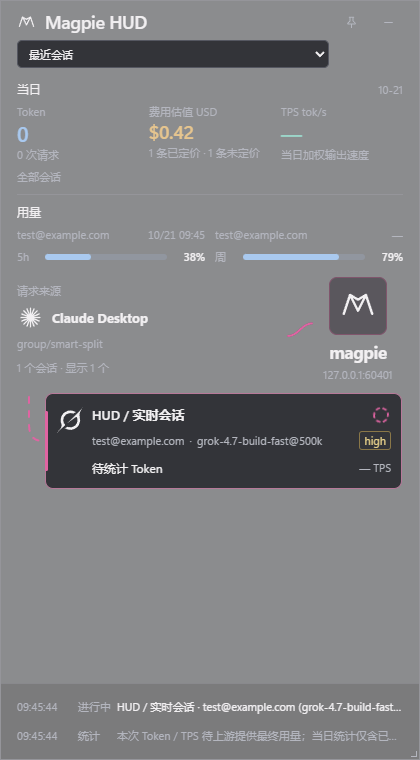
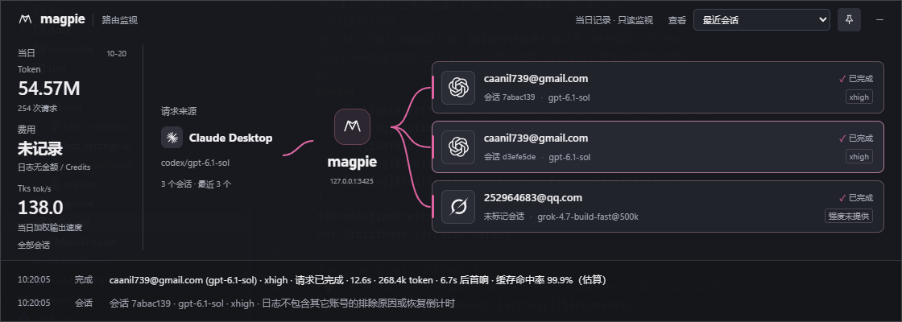
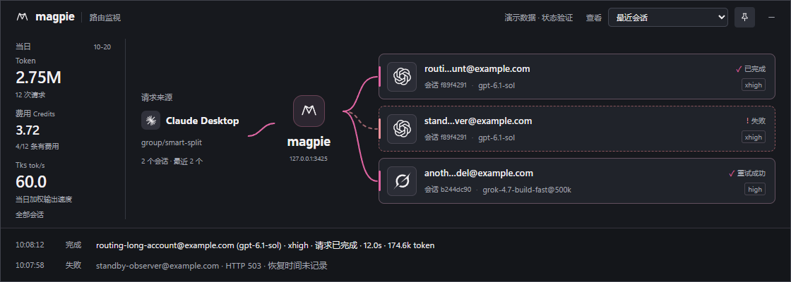

# magpie-hud

> **当前 `main` 就是这套 Tauri 2 应用。** 克隆后请用 Tauri CLI 2，在项目根目录执行 `cargo tauri dev`（发布包用 `cargo tauri build`）。不要安装 Qt，不要使用 CXX-Qt，也不要运行 `build.ps1`；那是已经替换掉的旧脚手架。

```bash
cargo install tauri-cli --version "^2.0.0" --locked
cargo tauri dev
```

使用 **Tauri 2 + 系统 WebView** 构建 Windows 独立悬浮窗。完成用量只读 Magpie 的 `usage.jsonl`，进行中状态只读本机网关 `/v1/magpie/trace` 与 `/v1/magpie/concurrency`；显示会话名称、流动路由及本次 Token/TPS，底部默认显示两行带本地时间的说明，高度不超过 420px 时收为 28px 单行。不修改 Magpie、不读取密钥、不集成进 rs_agent_router。

**当前状态：支持自由缩放、横竖布局、实时路由、账号额度和费用估值。** 标题为 Magpie HUD，主背景 50% 不透明度配合 Windows 桌面合成 Acrylic 磨砂，聚焦和失焦保持相同底色，文字保持清晰。横窗来源不超过两个时与 Magpie 纵向排列；竖窗并排，保留来源图标并放大 Magpie。默认窗口 1120×400；拖动边缘/角落调整宽高，长宽比小于 1.25 或宽度小于 680px 时自动使用纵向布局；来源超过两个且宽度小于 980px 时也使用纵向布局。统计、来源与会话块随尺寸重排；高度不超过 420px 时，统计精简为 `Token | TPS | 费用`，日志收为 28px 单行，拉高后自动恢复。完整需求见 [SPEC](docs/spec/magpie-route-float-SPEC.md)，2026-10-20 的会话/统计增量见 [M2 档案](docs/feat/Feat_261019_2_分流图与托盘.md)。原始 [HTML 原型](docs/ui/magpie-hud.html) 保留为早期设计参考，实际程序使用 `ui/index.html`、`ui/hud.css` 和 `ui/hud.js`。

## 当前主界面

V.0.0.32 当前运行窗口（2026-10-28，真实数据，账号信息已脱敏）：左侧显示当日统计、账号额度及模型用量分布，右侧显示会话与子 Agent，底部为实时路由决策。



路由决策按已确认的组路径和实际模型尝试展示，支持 Jev 等判定模型图标、轮初沿用、规则与轮次、判定耗时及会话悬停联动。耗时位于连线上方，低于 1 秒为绿、1 至不足 2 秒为黄、达到 2 秒为红；已确认经过的连线先展示至少 1 秒光点，再转为绿色实线，尚未确认部分保持浅灰。详见 [路由决策说明](docs/ui/decision-route.md)。

## Windows x64 下载

[GitHub Actions · Build Windows x64](https://github.com/smallcat2333/magpie-hud/actions/workflows/windows-x64.yml) 在推送到 `main`、推送 `v*` 标签或手动运行时执行 Rust 测试并构建 Windows x64 独立程序。

打开成功的运行记录，在 **Artifacts** 中下载 `magpie-hud-版本号-windows-x64`，解压后包含 exe 和 `SHA256SUMS.txt`。构建产物保留 30 天，下载通常需要登录 GitHub。这是独立 exe，运行环境仍需 Windows 10/11 WebView2 Runtime 和本机 Magpie。

## 运行

需要 Rust stable、Windows 10/11 WebView2 Runtime 和 **Tauri CLI 2**。本机已于 2026-10-20 确认安装 `tauri-cli 2.12.3`，替换原来的 1.6.1。

首次安装 CLI：

```bash
cargo install tauri-cli --version "^2.0.0" --locked
```

在项目根目录启动开发窗口：

```bash
cargo tauri dev
```

构建发布包（本次尚未执行）：

```bash
cargo tauri build
```

运行 Rust 单元测试：

```bash
cargo test --manifest-path src-tauri/Cargo.toml --lib
```

默认读取 `%USERPROFILE%\.config\magpie\usage.jsonl`，配置位于 `%APPDATA%\magpie-hud\config.json`。配置字段为 `usageJsonlPath`、`magpieHost`、`window` 和 `alwaysOnTop`；`magpieHost` 是实时数据的网关地址，只允许本机回环 HTTP（例如 `127.0.0.1:3425`），绕过代理、不跟随重定向。窗口尺寸和位置一起保存，重启恢复上次正常矩形，不恢复最小化哨兵坐标，也不强制回到宽模式。窗口不进入任务栏；最小化或隐藏按钮都会先记住正常位置，再收到托盘。置顶按钮控制窗口置顶。窗口空白处右键可“初始化位置”（恢复 1120×400 并在当前显示器工作区居中）或“隐藏到托盘”；托盘菜单提供显示、隐藏、初始化位置和退出，左键点击托盘图标也会恢复窗口。

日志在请求结束后写入，≤500ms 的刷新目标从完整记录落盘开始计算。启动以 64KB 分块流式汇总本地当日记录；运行中只读新增字节，半行留到完整后再处理。`kind=routing` 的内部分类调用不计入统计，重复行不重复累计。

## 自定义 Agent

来源图标可通过 [source-icons.json](ui/source-icons.json) 配置别名规则，未知来源使用机器人图标。图标随应用打包，规则修改后需要重新构建。

对话名称支持本机 `%APPDATA%\magpie-hud\session-titles\*.json` 标题快照，约每 2 秒刷新一次，按实际 session ID 精确关联。字段要求、写入路径和原子更新方法见 [自定义 Agent 接入说明](docs/integration/custom-agents.md)。

## 会话、状态与当日统计

- 右上“最近会话”显示全部进行中会话，再用最近完成会话补足可见数量。窗口更高时按卡片高度增加可见数，至少三个；活跃会话超过可见数时全部保留。旧完成会话被挤出默认视图后仍可从下拉列表选择，不按秒超时删除。仅实时存在而尚无完成日志的会话，结束/断线到日志落盘之间可能短暂消失；本地跨日或日志轮转重建会移除旧记录。选具体会话后同步路由、用量、底部说明及当日统计。会话名称读取 Desktop 本地元数据与 Codex `session_index.jsonl`，按完整 ID 映射；有 ID 但缺名称显示“未命名会话”，没有 ID 的记录直接隐藏，完整 ID 仅保留在提示与分组身份中。
- 路由块主行显示会话名和状态，次行显示模型、账号与强度，旁边是本次 Token/TPS。状态和强度在同一列内居中，横窗状态/强度列固定 48px、TOK/TPS 列固定 60px，剩余空间给前面的标题与模型/账号，缺失强度显示“待定”。第二行优先显示模型，账号可省略，分别悬停可查看完整值。普通活跃请求先使用蓝青色流动线；同一请求持续 15 秒仍没有首字依据时，其会话分支转黄色，收到正文依据后立即恢复蓝色。路由尚未分配、等待账号并发或请求速率、以及当前尝试结束后的路由切换也使用黄色。Magpie 当前接口不能实时报告首字，因此这个 15 秒提示仅表示“首字状态未确认”，不声称上游尚未输出；计时使用后端活跃请求耗时，刷新和会话切换不重置。主卡细边框及侧标与蓝/黄/绿/红分支颜色一致，悬停和选中不切为粉色。Agent 到 Magpie 的连接始终保持粉色。完成/重试成功为绿色，错误/取消/未知结果为亮红色静态虚线；Agent 到 Magpie 的连接始终保持粉色，仍在选择账号时使用分叉节点图标。候选计划中同一账号的重复行按完整身份合并判断，模型不匹配或 provider/账号有冲突时仍显示待定。强度 low、medium、high、xhigh、max、ultra 分别为浅蓝、绿、黄、橙、粉红、淡紫红，未知值保持中性。请求进行中显示“虚线圆＋运行”，明确等待为黄色，普通运行与已确认收到正文为蓝色；成功和重试成功均显示绿色“√ 完成”，取消显示红色“x 取消”，服务失败和未知状态显示红色“x 错误”；原始错误、HTTP 状态和完整说明保留在悬停提示。完成即停止动画；减少动态效果时仅关闭入场强调，持续状态动画保持原速。统计 Token、TPS 与费用分别以浅蓝、青绿和暖金区分。Token 千以上按三位有效数字缩写为 `k` / `M` / `B`（如 `988M`、`1.02B`），千以下保留整数，精确 Token 数保留在悬停提示。
- 同一会话始终只显示一张主卡：多条主请求同时活跃时展示路由 ID 最新的一条；全部结束后展示后端标记的当前完成记录；只有子 Agent 时显示一张会话锚点。其他请求仍保留在履历、额度关联和统计中，子 Agent 继续挂在主卡下方。
- 失败使用真实 HTTP 状态及错误；后端保留同一会话未被更新成功记录取代的失败、取消和未知根记录，主卡仍只展示当前一条。一旦有更新的成功根请求则清理更早的失败留档，按完成日志追加顺序判断。子请求成功、其他会话成功和进行中请求不触发清理。499 为调用方取消，不算账号冷却。后续成功或 `tries>1` 时统一显示“完成”，重试与恢复依据保留在提示和底部说明中。`usage.jsonl` 不含路由页的逐次失败账号、实时冷却和精确恢复时间，不能复刻“31 秒后恢复”倒计时。
- **Token**：按系统本地日期汇总 `in + out + cache_read`。日志中的 `t` 是请求开始时间；当天归属按该时间转本地日期，最新完成和恢复顺序按文件追加顺序，避免并发请求倒序。
- **子 Agent**：以内容宽度自适应的 30px 紧凑单行挂在父会话下方，图标、名称、模型、状态、强度和 TPS 按 6px 间距连续排列，不沿用主卡固定列宽；窄窗优先保留状态、强度和 TPS，名称与模型可省略，完整值可悬停查看。名称优先读取本地独立元数据的短任务描述，缺失时才使用编号。最近会话展示活跃子项，并在请求消失后保留 10 秒；期间显示匹配的完成状态或中性“间歇”，新请求恢复时沿用子项身份，重复快照不延长收起时间。选中具体会话后保留每个子 Agent 最近一次已结束请求；相同子 ID 活跃时只显示当前行。完成记录随当日账本保留，不表示完整的工具执行生命周期。
- **效率与均次费用**：六项统计为两排纯数字，等高等距，名称、精确值和计算口径可悬停查看。缓存命中率为 `Σcache_read / Σ(in + cache_read)`，保留一位小数；Token 千以上按三位有效数字缩写（`988M`、`1.02B`），千以下保留整数；TPS 使用三位有效数字。调用次数始终显示完整无分隔整数（如 `5140`），金额始终保持美元、不缩为 k/M：小于 10 保留两位、小于 100 保留一位、其余取整（`$1.23`、`$12.3`、`$1172`），均次费用同规则。调用次数为当前范围当日已结束请求（含主/子、不含内部 routing）；均次费用为 Magpie USD 估值除以已定价调用数（含内部 routing），按同一金额规则显示，低于一美分显示 `<$0.01`，精确值保留在悬停。统计区不追加单字“旧”，额度区移除“用量 / 旧读数”标题栏，读数时间和错误详情保留在悬停说明。没有缓存输入或已定价调用时显示破折号。Agent 到 Magpie 的粉色连接在当前展示范围有活跃模型请求时流动，间歇保留期间保持静止。
- **每小时迷你图**：统计下方显示 24 个小时柱位，蓝柱为 Token、黄色折线为金额；只标 `0h / 8h / 16h / 24h`，每隔 4h 绘制细竖虚线，水平参考线随当前最高点定位，不显示坐标轴线与 Y 刻度。图宽不超过 180px 或横窗高度不超过 420px 时，图高从 112px 减至 56px，隐藏 Token/金额图例及观测说明，仅显示图形、极值和时间；完整说明保留在悬停与辅助表格中。各单位按最小值 −5%、最大值 +5% 独立缩放，各标最高/最低（相同值合并），悬停或方向键可看精确数值。Token 按完成日志中的请求开始时间转本地小时，随会话筛选。全部会话的金额直接使用网关 `series` 的 24 小时历史，不依赖本地累计差额；有未定价调用的小时标记“部分观测”。网关不提供会话级小时序列，因此选中会话时只记录该会话之后连续轮询的真实累计增量，历史小时留空，不按 Token 拆分全局金额。会话缓存仅保存当日小时金额及会话 ID 到 `%APPDATA%\\magpie-hud\\hourly-cost.json`，不保存账号或正文；重启恢复已记小时并重新建立基线，断线超 30 秒不把离线增量塞到当前小时，跨日清空。子 Agent 强度为 10px，主卡为 11px。
- **费用估值**：只读 Magpie `/v1/magpie/usage?period=today` 的 USD 估值和未定价条数，选中会话时按 `sessions[].id` 显示该会话费用，每 5 秒刷新。订阅账号金额为等价用量估值，并非实际账单；费用沿用 Magpie 用量页口径（含内部 routing），而 HUD 的 Token/请求数排除 routing。无价格不伪造 $0.00，日志 Credits、账号余额各保留自身单位。
- **用量**：左栏第二部分读取 `/v1/magpie/quotas?kept=1` 的最近缓存额度，启动立即读取，之后每分钟更新；新请求完成后合并 2 秒内的完成事件补刷一次。保留上次读数，不为未匹配账号或“正在选择账号”绘制空进度条。当前显示范围中，实际选中的供应商和完整账号会显示额度。“最近会话”汇总当天全部会话，不限于右侧当前显示的三张卡片；选择单个会话时只显示该会话。自动分流时，外层分组供应商不参与额度匹配。5h、周等窗口没有模型限定时属于账号共享额度。每个账号只显示最短的一个窗口，例如同时有 5h 和周时只显示 5h。显示为两行：账号与重置倒计时（例如 `5d2h`、`5h2m`、`32m`，悬停可看准确重置时间）；窗口简称、已用进度条与百分比。账号放不下时自动省略，悬停可看完整账号；左栏不显示滚动条，超长列表仍可用滚轮查看。账号列表直接展示，不设“用量 / 旧读数”标题栏；详细模型、读数时间和错误放在悬停提示，失联保留旧读数。
- **TPS**：最近 10 个会话的加权输出速度 `Σout / Σ(ms − ttft_ms) × 1000`，仅纳入成功且生成耗时有效的记录；选中单个会话时只显示该会话。每块会话另显示本次请求对应的 Token/TPS。Magpie 活跃接口尚无执行中的精确输出计数，进行中显示该会话上一轮已完成请求的 Token / TPS，但卡片不额外标注“上轮”；没有上一轮时显示“-- TOK / -- TPS”。卡片 Token 使用默认文字颜色；TPS <30 为红，30–<60 为黄，60–<120 为蓝，120–<200 为绿，≥200 为紫；未提供 TPS 时为浅灰色。完成日志到达后改为本次最终值。`upstream` 包含等待首字与正在流式返回，不伪造逐 Token 进度。
- 模型与 Agent 图标来自 [LobeHub Icons](https://github.com/lobehub/lobe-icons) 的 `@lobehub/icons-static-svg` 1.95.1，优先使用品牌原色版本：Claude 橙色、Gemini 渐变、DeepSeek/GLM 蓝色，Claude Code 与 Codex 使用各自标志；OpenAI/Grok 的原版单色标志保留深色背景适用的浅色。已本地打包并保留 [MIT 许可](ui/icons/LICENSE)，应用运行时不联网加载图标。

## 验证状态

- 2026-10-19：`cargo test --lib` 5 项通过，调试构建通过。隔离进程在追加临时日志后仍存活；该检查不能证明前端已成功渲染或延迟达标。
- 2026-10-20：安装 Tauri CLI 2.12.3，执行 `cargo tauri dev`。修正前端字符串意外断行和 `router-host` 元素缺少 ID 后，实际窗口已显示真实账号、服务模型、统计及两行时间说明；已检查截图与辅助功能控件树。
- 置顶验证中曾关闭置顶，检查结束后配置与原生窗口标志均恢复为开启。按钮自动往返测试未完整通过，不计为全部交互验收。
- 2026-10-20 会话与统计增量：Rust 单元测试、`node --check`、1120px/720px 网页排版检查通过，实际 Tauri 截图已核对。隔离临时日志在真实 WebView2 完成会话切换、失败→恢复、半行处理、Credits 覆盖和当日统计验证，完整写入至界面更新实测约 141ms（单机样本，不代表所有环境）。
- 2026-10-20 feat-4：MSVC 环境下 `cargo test --lib --locked` 12 项通过，覆盖统计公式、空记录、异常日志、配置边界和窗口约束；`node --check ui/hud.js` 通过。
- 2026-10-21：实时会话版本的 14 项 Rust 单测与调试构建通过。隔离 WebView2 验证请求开始、标题改名、最终 Token/TPS 和断线处理；原回归刷新约 138.3ms。横竖截图为脱敏样本，见下方。
- 2026-10-21 额度侧栏：17 项 Rust 测试与调试构建通过，真实 WebView2 检查原生 Acrylic、50% 主背景、额度、全局/会话费用及尺寸恢复；完成日志回归约 123.9ms。人工观感与真实账目比对留待用户确认。
- 2026-10-21 v0.0.3：18 项 Rust 测试与 release 构建通过；额度首项插入、单/双账号与会话切换、重置倒计时、连线端点和连续底线已在浏览器验证。隔离模拟网关驱动 release 截图核对单 Grok 19% 及 GPT 40% + Grok 19%（演示数据）。当前环境的原生 CDP 端口无法连接，原生 CDP 自动回归未通过；release 显示采用原生截图核对。
- 2026-10-21 v0.0.8：21 项 Rust 单元测试、JavaScript 语法检查和 release 构建通过。浏览器在 690×340、1120×850、360×760、420×1100 检查短状态、整数 Token、状态/强度居中、最短额度窗口、单会话筛选和动态数量；无横向溢出。原生 release 临时副本通过位置恢复、移动保存、立即最小化、立即关闭、重启恢复、右键初始化和隐藏，以及窗口可见时任务栏按钮缺席检查。
- 待人工确认：真实请求刷新、鼠标边缘缩放、托盘完整交互、长时间运行、跨日实机、多屏/DPI 热插拔。

实时会话横向与纵向窗口（脱敏样本）：






此前会话路由窗口（旧版）：



失败、重试成功和费用覆盖的脱敏演示（用于检查状态，不是生产数据）：



可重复的隔离桌面验收脚本（需要 Python 的 `websocket-client`，先调试构建；脚本只写临时目录，关闭自己启动的测试窗口）：

```bash
python scripts/verify_routing_window.py
```

早期开发窗口截图（2026-10-20；截图中的账号和记录为当时状态）：


## 变更记录

当前程序版本是 `1.0.2`，标题显示为 `Magpie HUD V.1.0.2`。上方截图来自 v0.0.32，保留为实际运行示例。

2026-10-29 | 1.0.2 | 增加 SWE-2 / Devin 彩色品牌图标；额度详情浮层在供应商名称与账号两行左侧显示对应供应商图标；修正同一会话多条主请求时子 Agent 连线穿过中间主卡的问题。

2026-10-29 | 1.0.1 | 路由决策按用户输入轮次保留轮初判定、耗时和模型，同轮 Agent 内部请求不再覆盖或重播决策链；缺少轮初记录时明确提示，不用内部请求代替。

2026-10-28 | 0.1.0 | 增加跨窗口账号打码开关，统一主界面、请求履历与用量详情中的账号显示；完善数值缩写和界面排版，统一应用版本为 0.1.0。

2026-10-28 | 0.0.32 | 新增真实路由决策链、判定模型图标与耗时配色、轮初沿用与会话悬停联动；已经过的连线至少展示 1 秒光点后转为绿色。完善模型用量统计、费用匹配及最多四行标签，更新当前主界面截图。Rust 库测试 100 项通过。

2026-10-21 | 0.0.25 | 六项统计统一为等距纯数字和详细悬停，缓存一位小数、调用显示完整整数、金额与均次费用按 10/100 阈值固定小数位且不缩单位；普通请求保持蓝青色，超过 15 秒仍无首字依据转黄色，主卡边框与侧标随分支同色，入口始终粉色；子 Agent 空闲保留 10 秒，较新成功根请求清理同会话更早失败留档。

2026-10-21 | 0.0.24 | 单会话详情展示已结束子 Agent 请求，子项增加强度并使用可用任务名称；统计增加缓存命中率、调用次数与均次费用，Agent 到 Magpie 的粉色连线仅在有模型请求时流动。

2026-10-21 | 0.0.23 | 修复运行线割裂感：恢复 1 秒无缝循环，数据刷新时复用已有连线，不再重启动画；系统减少动态效果时也保持原速。错误线继续静止，子 Agent 短线使用同一机制。

2026-10-21 | 0.0.21 | 活跃子 Agent 从同名大卡改为所属会话下方的单行挂载项，缩进 18px、高 36px，独立展示模型与运行状态。只保留有活跃模型请求的子项，完成后收起；主会话及子 Agent 的上轮指标各自取值，当日统计和账号额度保留子 Agent 用量。

2026-10-21 | 0.0.20 | Magpie 到会话卡片的运行分支改为蓝青色流动线，错误、取消和未知结果使用亮红色静态虚线，完成仍为绿色；Agent 到 Magpie 的粉色连接保持不变，分支颜色独立于指标与状态文字。

2026-10-21 | 0.0.19 | 移除来源节点上方的“请求来源”标签，保留来源图标、名称和路由连线。

2026-10-21 | 0.0.18 | 隐藏所有没有 `session` 的完成记录和实时请求，不再生成“未标记会话”，也不计入当日统计与会话数；有会话身份的记录照常显示。

2026-10-21 | 0.0.17 | 矮窗统计分隔竖线改为固定 10px 的细线，在 22px 统计行内垂直居中，消除字符竖线与数字的字形错位，保留三等分布局。

2026-10-21 | 0.0.16 | 按 Magpie 供应商清单补齐本地图标：小米 MiMo、Qwen、Kimi、MiniMax、Mistral、StepFun、Groq、Ollama、OpenRouter、Copilot、Vertex、Bedrock、Azure、百度、腾讯云、华为云、火山引擎、豆包、Z.ai、Together、Fireworks、SiliconFlow、NVIDIA、ModelScope、Cline、OpenCode、Cloudflare、Workers AI、Nous、Antigravity、Gemini CLI、xAI、302.AI、AiHubMix、Command Code、Kilo、Cherry Studio、Fish Audio、百炼、混元。有彩色版用彩色，没有的单色固定为浅色。

2026-10-21 | 0.0.15 | 矮窗统计改为 Token、TPS、费用三等分并各自居中；左栏略收窄。会话列表、用量和竖窗内容区隐藏滚动条但保留滚轮。标题栏增加直接关闭按钮，最小化继续进入托盘，均不弹确认。

2026-10-21 | 0.0.14 | 无会话身份且输出不超过 200 Token 的记录（开新会话时的辅助调用）不再单独成卡，也不计入当日统计与会话数；有会话身份的记录照常保留。会话计数移到 magpie 产品名下方，格式为 `34会话, 显示4个`。

2026-10-21 | 0.0.13 | 横窗右侧固定状态/强度与 TOK/TPS 列宽，数字变化不再带动列位置，剩余空间给标题和模型/账号；卡片 Token 单位改为 TOK，空值为 `-- TOK`。

2026-10-21 | 0.0.12 | 识别同账号重复候选计划行，冲突身份仍保持待选。强度未知显示“待定”；选路阶段用分叉节点图标。连线按卡片状态显示：运行/排队粉色流动、完成/重试成功绿色、错误/取消/未知结果红色。第二行模型优先，账号可缩略，模型和账号悬停保留完整值。

2026-10-21 | 0.0.11 | 修复卡片隐式空网格行造成的内容偏上；横窗卡片高度由 76px 压至 68px，标题/账号/图标居中，右侧 Token/TPS 上移 3px。竖窗去除多余网格行，动态会话容量同步调整。

2026-10-21 | 0.0.10 | 卡片 Token 恢复默认文字色，TPS 保留速度分档；模型和 Agent 使用本地品牌原色图标，Claude 橙色、Gemini 渐变、DeepSeek/GLM 蓝色，Codex 与 Claude Code 使用各自标志；OpenAI/Grok 保留原版单色标志。

2026-10-21 | 0.0.9 | 无统计值显示 `-- Token` / `-- TPS`。卡片 Token 与 TPS 随 TPS 区间同色：低于 30 红、30–<60 黄、60–<120 蓝、120–<200 绿、200 及以上紫；未知 TPS 用浅灰。

2026-10-21 | 0.0.8 | 卡片 Token 改为整数且不再标记上轮；状态和强度居中。每个账号只显示最短额度窗口。窗口记住位置，右键可初始化，最小化隐藏到托盘且不显示任务栏。窗口更高时自动增加显示的会话数量。

2026-10-21 | 0.0.7 | 进行中请求显示该会话上一轮已完成的 Token / TPS，并明确标记“上轮”；没有上一轮时仍显示待统计。

2026-10-21 | 0.0.6 | 请求来源去掉路由组/请求模型文字与提示，仅显示 Agent 名称；Agent 图标从 22px 放大到 34px，横竖布局保持同样大小。

2026-10-21 | 0.0.5 | “最近会话”的用量改为汇总当天全部会话，不再只取右侧当前显示的三张卡片。

2026-10-21 | 0.0.4 | 异常状态按类型显示为红色“x 已取消”“x 失败”或“x 状态未知”，原始错误保留在悬停提示。

2026-10-21 | 0.0.3 | 修复额度首项未插入造成的空白或只显示第二账号；运行连线增加连续底线并贴合卡片；重置时间改为 `5d2h`、`5h2m` 等剩余时长，悬停显示准确时间。

2026-10-21 | 0.0.2 | 修正自动分流中 GPT 实际供应商与额度匹配；出口连线从 Magpie 方块右侧完整绘制。标题显示 `V.0.0.2(2026/10/21)`。

2026-10-21 | 0.0.1 | 标题版本从 `0.0.1` 起按改动递增；全局 TPS 改为最近 10 个会话。此前变更记录未单独编号。

2026-10-19 | 归档路由悬浮窗 SPEC，建立 M1/M2/M3 三份需求档案。

2026-10-19 | 按用户授权自行设计 WebView UI，新增独立 HTML 原型及本地预览配置，归档三份 FEAT §2。

2026-10-19 | 用 Tauri 2 替换 RSQt 脚手架，接入日志监视、两行说明、三节点、托盘和配置；完整行为待系统验收。

2026-10-20 | 修复前端字符串断行及地址元素缺少 ID 引发的启动渲染失败，确认 CLI 2.12.3 开发启动与真实数据画面，归档运行截图。

2026-10-20 | 增加当日 Token/Credits/Tks、按会话查看与模型图标两行路由块；区分失败、取消和重试成功，改为增量读取，实测隔离 WebView 刷新约 139ms。

2026-10-21 | 开放边缘/角落自由缩放和横竖布局；按 Magpie 源码接入活跃请求及真实会话名称，增加本次 Token/TPS 与执行中流动连线。

2026-10-21 | 来源不超过两个时纵向排列，增加账号额度侧栏和 Magpie 费用估值；50% 半透明 Acrylic、来源图标和六档强度色；默认显示全部活跃会话。

## SOP的开发信息

### Feat

| 编号 | 简述 | 阶段 | 描述 |
| --- | --- | --- | --- |
| [Feat_261019_1](docs/feat/Feat_261019_1_悬浮窗基础闭环.md) | 悬浮窗基础闭环 | 开发 | 程序自测通过；窗口、真实刷新和异常界面待人工确认。 |
| [Feat_261019_2](docs/feat/Feat_261019_2_分流图与托盘.md) | 分流图与托盘 | 开发 | 程序自测通过；图文、动画和托盘待人工确认。 |
| [Feat_261019_3](docs/feat/Feat_261019_3_多屏与配置.md) | 多屏与配置 | 开发 | 配置与边界计算通过；位置恢复和多屏待人工确认。 |
| [Feat_261021_1](docs/feat/Feat_261021_1_窗口横竖自适应.md) | 窗口横竖自适应 | 测试 | 原生宽/高缩放、横竖重排及工作区下限已接入，待用户体验确认。 |
| [Feat_261021_2](docs/feat/Feat_261021_2_实时会话与单次统计.md) | 实时会话与单次统计 | 测试 | 14 项 Rust 自测与实际 WebView2 隔离验收通过；请求中动画、名称和本次指标已接入。 |
| [Feat_261021_3](docs/feat/Feat_261021_3_额度侧栏与磨砂布局.md) | 额度侧栏与磨砂布局 | 测试 | 接入 Magpie USD 估值、最近账号额度，调整横竖来源布局、磨砂与强度色。 |
