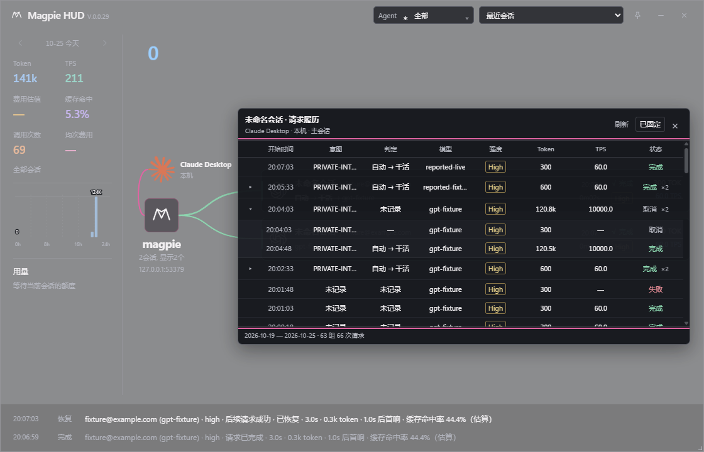

# Feat_261025_1 会话请求履历

> 状态：4 MiB 尾部扫描、秒级（1s）刷新与动画平滑已安装并重启；真实履历已确认快速呈现与平滑重绘；人工确认待用户填写
> 应用：magpie-hud
> 创建：2026-10-25　　关闭：-

## 1. 需求

### 1.1 背景与目标

用户希望鼠标移到会话图块后，看到每次请求的履历表：判定结果、模型、强度、Token、TPS与状态，并要求小字号。主会话和子 Agent 各自对应自己的请求；一行代表一次真实请求。

### 1.2 验收标准

- 悬停打开共享履历表，正文11px、标题12px，列为开始时间、判定、模型、强度、Token、TPS及状态。
- 判定只展示规则目标/路由；强度单列复用会话图块的同款标签与等级配色。
- 可移入、滚动、固定、刷新和关闭；键盘可操作，卡片持续重绘不打断固定履历。
- 完成、失败、取消、未知和运行状态明确；运行用量未知时不借用上轮数据。
- 仅使用本地只读日志和已有实时数据。缺失路由判定显示未记录，不读取消息正文、不输出规则表达式或原始错误。
- 查询有日期、字节和行数边界，覆盖范围可见；不增加费用和额度查询。

## 2. 原型

### 2.1 布局

共享浮层宽720px，限制在HUD当前窗口内；约10行可见，表头固定，仅允许纵向滚动。列顺序为展开、开始时间、意图、判定、模型、强度、Token、TPS、状态，表头与内容全部居中。展开列24px，强度列固定72px，标签完整显示；其余列随宽度收缩，长文本省略。顶部会话名与来源，右侧刷新、固定和关闭。正文11px、标题12px、数值使用等宽数字，沿用现有状态色且有文字状态。2026-10-25 浏览器360px/560px窄窗确认无横向溢出、Medium完整；原生66根行/1子行回归通过。2026-10-25 用户允许重启后已完成更新，新进程7932；安装文件SHA256与验证release一致（cb6e4f50e709c525），窗口位置/尺寸/置顶保持。

### 2.2 交互与数据

- 两层折叠：一行对应一次用户输入，组内请求可展开为子行（×N 标记请求数）。开始时间前新增24px展开列，表头无文字、以 aria-label 说明；展开状态按组记忆，刷新后保留。
- 悬停400ms打开、离开图块和面板200ms关闭；固定后锁住当前身份，Esc或外部点击仍能关闭。Alt+向下键进入表格。
- 近7个本地自然日、初始50组、可展开200组；最多读取日志末尾4 MiB，提示截断。条数限制按组计，截断点落在组边界。
- 主会话采用显式alias，子Agent按原始父ID与子ID精确查询。标题不参与归属判断。
- Token为最终日志条目的输入+输出+缓存读取；中间handed_on计费不作为独立最终请求。TPS沿用HUD生成速度口径。Token列用带单位紧凑格式（如 225.2k，百万级用 M），保留一位小数，精确值在单元格说明中。
- 当前数据源不提供提示词文本，已排查确认：usage.jsonl 无文本字段、trace.prompt 仅token统计、route 接口仅路由元数据、网关正文仅内存不落盘。按用户决定移除提示词列。
- 模型列只显示最终模型（发送模型优先响应报告模型）；发送/报告模型、账号、供应商保留在单元格说明中。路由链条仅在判定列展示，不与模型列重复。

## 3. 开发任务

### 3.1 路线图

| 编号 | 任务 | 依赖 | 状态 |
| --- | --- | --- | --- |
| T1 | 共享记录解析、有界履历查询和实时身份匹配 | - | 完成 |
| T2 | 常驻共享浮层、卡片身份及重绘协调 | T1接口 | 完成 |
| T3 | Rust、浏览器和原生IPC验证，构建更新 | T1、T2 | 完成 |

### 3.2 开发记录

- 2026-10-25：履历独立于RouteSnapshot及费用详情，按需查询；浮层由独立history.js/css维护，卡片只提供稳定scope。
- 2026-10-25：按反馈调整为提示词→开始时间→判定→模型→强度→Token→TPS→状态；判定移除强度，强度复用图卡effort标签。提示词文本在现有日志/trace中缺失，暂显示未记录；浏览器隔离文本已验证单行省略。候选逐会话接口读取被自动审批以私人提示词数据处理为由拦截，未绕过。
- 2026-10-25：用户授权后读取候选接口 /v1/magpie/route?session=<id>，确认仅返回该会话最新一次路由的决策元数据，无提示词文本。四个可能来源全部排除后，按用户决定移除提示词列；模型列改为显示完整路由链条（组名 → … → 最终模型），面板由760px收窄至640px。浏览器预览与原生脚本（66根行/1子行）均验证通过。
- 2026-10-25：用户指出判定列与模型列路由链条重复，模型列改回仅显示最终模型；同时按用户要求 Token 列改为带单位紧凑格式（120.5k，百万级 M），精确值保留在悬停说明。原生脚本新增对应断言，66根行/1子行回归通过。
- 2026-10-25：按用户要求新增意图列（判定之后、模型之前）。数据取实时 trace 的 rule.classified.intent 与 sure（本轮命中意图与置信度），不导出候选清单；超长文本截断到 14 字，完整意图与置信度在悬停说明。usage.jsonl 不保存意图，仅 trace 保留期内可用，其余显示未记录。Rust 84 项与原生脚本（含截断与脱敏断言）通过。
- 2026-10-25：用户第五次允许重启后，意图列版已更新并启动，新进程28860；安装文件SHA256与本次验证release一致（ee618f94e0920fa9），原窗口位置3571/203、尺寸891×1023、置顶关闭均保持。
- 2026-10-25：用户要求一行对应一次输入（可能含多轮请求）。关联方式先验证后实现：网关数据无任何按输入的标识（usage 行字段与 trace 路由字段均无），转写稿 promptId 关联只覆盖约一半行（共享原生会话的兄弟会话不写本会话转写稿），否决。采用上游规则判定的轮次序号：rule.turn 是请求体中用户输入的计数，同一输入内的后续请求保持不变（held=true 沿用该轮开始时的判定）。HUD 按 route_id 累积轮次元数据（上限 8192，网关重启清空），履历查询按开始时间正序归组；无轮次记录的请求各自成组。组摘要：意图取开口请求（分类失败沿用上一轮时标注，本轮无意图时回退上一轮线索），判定取开口请求组链，模型/强度去重列举，Token 合计（任一缺失则未知），TPS 为组内输出合计÷生成时长合计，状态取最重者。条数限制按组计，截断不拆组。标题生成/压缩等辅助调用（kind 非空或 rule.compact）不参与折叠。已知边界：共享同一原生会话的兄弟会话在网关数据中不可区分，可能被并进同一组，与会话卡片本身的合并口径一致。Rust 87 项通过。
- 2026-10-25：首次安装后在真实数据上发现「连续同轮次」归组失效（27 组仅 7 组折叠）。原因是同一原生会话同时交错着多条会话线，turn 在 2/1/2/1 之间交替，且续行的 held=true 早就指明了归属。改为按「会话线＋轮次」索引开口组：held=false 的开口请求总是新开一组并登记为该轮最新开口组，held=true 的续行挂回该轮最近的开口组（可跨过中间其它轮次的行），找不到开口（落在 trace 窗口外）时续行自成一组、后续同轮续行再并入，开口后到的矛盾数据不反向合并。TraceRule 相应接收 held/grown，TurnRecord 记录 held，组摘要与截断口径不变。Rust 87 项通过；原生脚本修正了自身夹具的时间顺序错误（原先让 route 2 早于 route 1，续行先于开口到达，与真实流量相反），66 根行/1 子行、折叠展开、50→200 组均通过。

- 2026-10-25：真实 trace 样本 60 条中 held 仅 2 条、waits 为 36 条。核对上游 rules.go 的 ruleFor：waits 只在 within 分支赋值，含义是同轮续行但未持有轮初判定（或规则改变），不能因 held 缺失而另开组。TraceRule 接收 waits，续行判断改为 held || grown || waits；新增 JSON 反序列化至轮次索引的回归测试，原生夹具加入 waits 请求。88 项 Rust 测试与实际 WebView 验证通过。已安装并重启至进程 40552，安装与验证产物 SHA256 均为 39d3d132502361953c52972d1a25862a0a451a2d9fe4a185a855e081599599d6；窗口 3586/203、876×1023、置顶关闭保持。实际履历置前并固定，截图确认出现 ×37 组（37 次请求合并）。未使用 affinity.why 或按 turn 全量合并的推测方案。
- 2026-10-25：按用户要求将履历扫描上限从 16 MiB 收紧为 4 MiB，提示信息同步更新；前台定时轮询由 2 秒缩短至 1 秒，并降低客户端缓存时间（2s → 1s），实现秒级呈现（原生实测新请求写出后 64ms 查见）。优化卡片过渡动画（motion.js）：重绘快照时捕获正在进行的 transform 关键帧与进度，节点重建后在原地接续剩余动画时间，消除每次快照刷新从 0% 重新缓入造成的顿挫；微调出入场位移（入场 12px→6px、退场 9px→4px）。浏览器 CDP 与原生测试全部通过。用户允许重启后完成安装，新进程 15728，安装文件 SHA256 为 7685a29b88424eaf67e08e125852896b4cb60cf22d85de37969b6e30f73a522e；窗口 3586/203、876×1023、置顶关闭保持。实际截屏确认 4 MiB 提示生效，出现 ×2、×5 等折叠组，意图、判定、模型正常显示。

## 4. 测试记录

### 4.1 程序自测

| # | 项目 | 方式 | 结果 |
| --- | --- | --- | --- |
| 1 | JavaScript语法 | node --check | 通过 |
| 2 | 11px字体、固定跨重绘保留滚动、Esc/外部关闭、移入与离开延迟 | 浏览器preview隔离数据 | 通过 |
| 3 | 360×520窄窗、900×240矮窗，浮层不越界且可滚动 | 浏览器preview测量 | 通过 |
| 4 | 快速切换scope时旧响应拒绝、真实零与未知区分 | 浏览器preview延迟返回 | 通过 |
| 5 | 完成/失败/取消/缺失计数、handed_on、alias/子隔离、边界扫描、重启与live合并 | Rust全量测试 | 84项通过，其中新增10项 |
| 6 | 完成数据与实时交接、真实鼠标和固定滚动 | scripts/verify_history_window.py 实际Tauri WebView | 通过：66根行/1子行；live用量为空、完成仅一行；50→200展开；固定滚动保留 |
| 7 | release构建 | cargo build --release --locked --offline | 通过；产物src-tauri/target-v008/release/magpie-hud.exe |
| 8 | 7列（无提示词）、判定无强度、effort图卡标签、Token紧凑单位 | 浏览器＋原生脚本 | 通过；原生66根行/1子行回归通过，用户允许重启后已完成四次安装（进程51276，SHA ed3ebfc38310af34） |
| 9 | 两层折叠：同轮续行合并、组摘要、展开/收起、按组截断 | Rust全量测试 | 87项通过（新增3项：轮次累积与范围过滤、上限淘汰、折叠分组与组摘要） |
| 10 | 折叠面板交互、×N标记、组行合计与精确值 | 浏览器preview隔离数据 | 通过：展开3请求组得子行，收起复原；无横向溢出；组行Token说明含精确合计与记录条数 |
| 11 | 原生折叠表、9列表头、展开断言、50→200组 | scripts/verify_history_window.py | 通过：66根行/1子行；三对开口/续行折叠；组行展开/收回；子行120.5k精确值；50组截断与200组展开；固定滚动保留 |
| 12 | 交错会话线的归组（续行跨过其它轮次仍归本轮） | Rust全量测试＋原生脚本 | 通过：单测覆盖交错与开口缺失、开口后到三种情形；原生脚本改为真实时间顺序的夹具后通过 |
| 13 | held / waits / grown 续行解析与压缩排除 | Rust全量测试＋原生脚本 | 88项通过；原生验证包括两对 waits 续行及展开子行截图 |
| 14 | 修正版安装、重启及真实数据展示 | 安装哈希对比＋实际窗口截图 | 通过：进程40552，安装哈希与验证产物一致；真实履历显示×37折叠组，窗口设置保持 |
| 15 | 4 MiB 扫描上限、秒级（1s）刷新、动画连续性接续 | Rust单测＋浏览器评估＋原生脚本＋实际窗口截图 | 通过：88项Rust测试通过；原生实测写出后 64ms 查见；浏览器测得动画接续位移跳变 0px；用户允许重启后进程 15728，哈希一致，真实截图确认 4 MiB 提示与平滑刷新 |

原生验收最初因测试条件直接返回DOM节点，CDP序列化后不保留其布尔语义而超时；改为显式布尔条件后完整流程通过。截图见下方。首次替换被自动审批拦截，2026-10-25 用户明确允许重启后已完成本机更新；新进程22344，安装文件SHA256与已验证release相同。窗口位置3571/203、尺寸891×1023、置顶关闭均保持。未提交、未推送、未改版本号。

2026-10-25 用户再次允许重启后，列布局调整版已更新并启动，新进程21688；安装文件SHA256与本次验证release一致，原窗口位置/尺寸/置顶状态保持。提示词候选接口读取未包含在此次重启授权内，仍未继续。

2026-10-25 用户第三次允许重启后，移除提示词列、模型列路由链条版已更新并启动，新进程36104；安装文件SHA256与本次验证release一致（62198dec3117fb51），原窗口位置3571/203、尺寸891×1023、置顶关闭均保持。

### 4.2 人工确认

| # | 操作 | 预期 | 结果 | 备注 |
| --- | --- | --- | --- | --- |
| 1 | 悬停主会话与子Agent | 分别展示对应履历 |  |  |
| 2 | 移入、固定、滚动并等待刷新 | 面板稳定且保持查看位置 |  |  |
| 3 | 对照Magpie请求记录 | 模型、强度、用量、速度与状态一致 |  |  |
| 4 | 点击×N组的展开/收起 | 子行按请求展开，组行合计与状态符合预期 |  |  |
