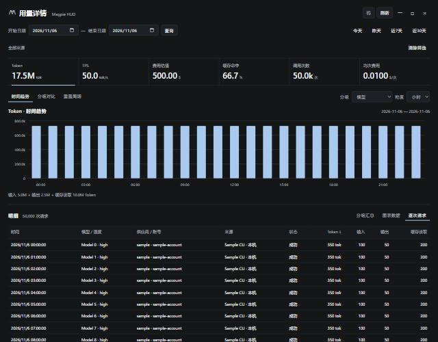

# Perf_261106_3 用量详情分页与聚合

> 状态：已验证待确认
> 应用：magpie-hud
> 创建：2026-11-06　　关闭：-

## 1. 目标
### 1.1 优化对象与动机
处理 issue 6：完整详情和费用逐行返回 WebView；逐请求表格显示 30 行前先构造所有行统计与本地化时间，造成大样本卡顿。

### 1.2 验收阈值
- 50,000 请求、10 模型、固定脱敏费用，Node 执行真实前端表格函数，三次中位：逐请求首页构造耗时降低至少 90%。
- 原生 IPC 只返回数据集摘要和最多 30 条表格记录，固定样本视图 JSON <256 KiB，不再传 50,000 条请求与费用行。
- 保持加权 TPS、缓存率、费用覆盖、全范围筛选/排序/翻页/下钻、周期半开区间口径。
- 后台数据集缓存有界；过期句柄报错可刷新恢复，不返回错误范围的数据。

## 2. 基线
固定 50,000 请求、10 模型、单来源与账号、逐条费用样本：完整 JSON 33,957,028 字节。Node VM 执行真实 `details.js` 的 renderTable，DOM 使用无绘制桩，三次 4159.282 / 5163.488 / 5512.842ms，中位 **5163.488ms**。包含时间本地化、全行统计、分组及排序，不包含原生 IPC、DOM 布局和绘制。样本生成及口径见 `tests/details-performance.cjs`。所有性能样本为合成数据，不依赖网关或真实日志。

## 3. 优化记录
### 2026-11-06 先分页再构建逐请求行
- 依据：真实 renderTable 在 slice(30) 前先为 50,000 行生成本地化时间和完整统计，并无条件计算分组。
- 改动：`ui/details-data.js` 增加轻量排序与 requestPage；`ui/details.js` 仅为当前页 30 行计算统计和格式化。排序仍覆盖全部匹配请求，未知费用排在已知费用之后，0 费用保留。
- 首轮同口径三次 10.251 / 11.307 / 54.050ms，中位 **11.307ms**，相对基线降低 **99.78%**。
- 最终同口径三次 6.383 / 7.545 / 37.215ms，中位 **7.545ms**，相对基线降低 **99.85%**。此处只计保留的本地数据路径在 Node VM 内的表格构造；原始完整样本仍为 33,957,028 字节，原生后台路径的响应体积另测如下。
- 流程图：无。

### 2026-11-06 后台数据集与分页视图
- 依据：前端分页可以消除全行格式化，但完整请求和费用仍要序列化、跨 IPC 传输并在 WebView 保留；需要将统计与分页放到后台。
- 改动：`src-tauri/src/detail_view.rs` 将完整行与费用保留在独立后台缓存；初次返回句柄、筛选选项、周期及警告，后续请求返回总体统计、受限图表分组和当前表格页。`lib.rs` 在 Runtime 锁内只复制配置，扫描与视图计算交给阻塞任务执行。
- 改动：前端异步视图按句柄/筛选/排序/页面合并查询并缓存，慢响应不能覆盖当前页；不同周期的同日期/账号范围复用数据集查询，费用网络查询不按翻页重新执行。分组标签按前端中文本地化顺序分页。
- 缓存：后台采用 LRU，最多 32 个数据集、600,000 条请求；前端视图缓存最多 64 项、周期范围缓存最多 32 项。详情窗口销毁时清空数据集，epoch 校验拒绝关闭前尚未完成的查询重新写入缓存。
- 同一 Rust 合成样本、同一序列化方法：原完整 DTO **20,668,138 字节** → 摘要 **386 字节** + 视图 **23,434 字节**，合计 **23,820 字节（约 23.3KiB）**，减少 **99.88%**。该 Rust 样本与 Node 样本字段内容不同，不能将两者的完整 JSON 体积直接比较。
- 最终独立导出版本 release 测量，50,000 行视图计算三次 53.893 / 53.936 / 57.552ms，中位 **53.936ms**。先前共享工作区测量中位 57.784ms；两轮均为后台视图计算，不含初始日志扫描、网关费用请求、IPC 传输和 WebView 绘制。
- 浏览器合成预览执行真实后台分页与真实详情脚本，通过本机 HTTP 适配 Tauri invoke；已验证摘要不含完整 rows、逐请求每页最多 30 条、全量排序、模型筛选、图表下钻及无横向溢出。预览日志中多个视图响应约 23–33KiB，均低于 256KiB 阈值。
- 流程图：无；项目未发现需同步的相关流程图。

## 4. 正确性验证
- 输出对比：合成预览的全量、模型筛选、周期筛选及空集统计与原 JavaScript aggregate 一致；逐请求页身份与全范围排序后切片一致，时间下钻仅影响表格范围，保留上方总体统计。
- 后台回归覆盖：加权指标，零费用与未知费用，多请求费用组完整匹配，周期 `[start,end)`，筛选交集，全范围排序后分页，趋势合并与下钻，分组图前 16 项与完整分组表，中文标签顺序，LRU 淘汰、过期句柄、窗口关闭后释放与拒绝迟到写入，非法选项，以及 50,000 行响应体积断言。
- 前端 Node 回归：`details-data`、`details-paging`、`history-refresh`、`model-usage-loading` 全部通过；共享工作区的 `hourly-costs` 回归也通过。实际详情脚本 VM 覆盖 30 行上限、全范围排序后分页、乱序响应、页缓存、过期错误、刷新恢复、分组下钻、周期半开区间与日期范围复用。
- Rust release 全套：共享工作区 **144 通过、0 失败、3 忽略**；随后从已提交 HEAD 导出源码，仅叠加本次改动，**138 通过、0 失败、3 忽略**，该独立版本另通过上述 4 组 Node 回归。两套测试数差异来自共享工作区其他未提交修改；手动预览服务是被忽略测试之一，普通回归不会启动常驻服务。
- 浏览器检查：50,000 行、10 模型，翻页与时间排序、模型筛选后 5,000 行、图表下钻、费用和加权统计一致；无控制台错误、失败网络请求或横向溢出。截图见下。
- 前端语法及代码版本检查通过：版本元数据与前端资源版本为 **1.0.31**。README 中本次条目留待用户确认后补写。

## 5. 结论
已达到本档案的 50,000 行验收阈值：本地逐请求表格构造中位耗时减少 99.85%，后台摘要与首屏视图的 JSON 合计体积减少 99.88%，全量明细不再进入原生 WebView，统计及筛选/排序/分页语义通过回归。

上述百分比分别对应前端表格构造和后台序列化体积，不代表端到端打开详情耗时。后台仍需扫描匹配请求并计算视图，首次日志读取、费用查询，以及 200,000 行真实数据的端到端耗时尚未在本次口径中测量；浏览器使用合成 HTTP 适配器，未替代真实 Tauri WebView 的现场验收。

状态保留为已验证待确认。按 smallcat-perf 流程，用户确认后才补写本次 README 条目并提交；未提交本次改动，未推送、关闭 GitHub issue 或重启正在运行的 HUD。
